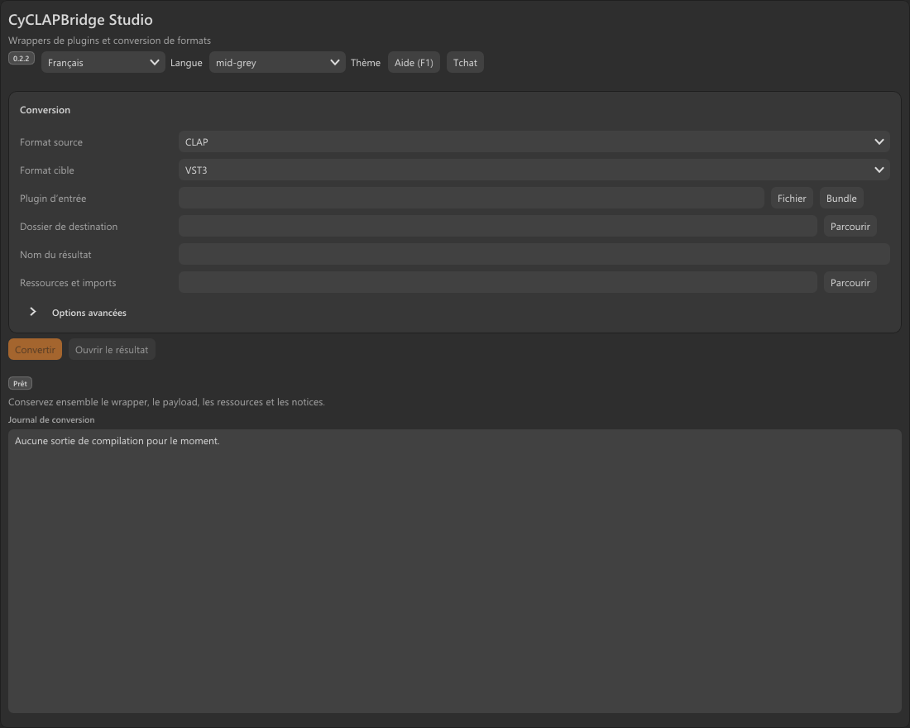

<table width="100%">
  <tr>
    <td width="300" align="left" valign="top">
      <a href="https://mrmybal.github.io/CyCLAPBridge/#/fr/overview">Manuel en ligne (0.2.0)</a><br>
      <a href="Documentation/Documentation.html#/fr/overview">HTML hors ligne</a><br>
      <a href="https://github.com/MrMybal/CyCLAPBridge">Dépôt</a><br><br>
      <sub>README</sub><br><a href="README.md">English</a> · <a href="README.fr.md">Français</a>
    </td>
    <td width="400" align="center" valign="middle"><strong>CyCLAPBridge</strong><br><sub>C++20 · Studio · CLI</sub></td>
    <td width="300" align="right" valign="top">
      <p><sub>Licence de l’application</sub><br><a href="LICENSE"><strong>MIT</strong></a></p>
      <p><sub>Version</sub><br><a href="VERSION.fr.md"><strong>0.2.2</strong></a><br><strong>EN DÉVELOPPEMENT</strong></p>
      <a href="https://github.com/MrMybal/CyCLAPBridge/releases/download/v0.2.2/CyCLAPBridgeStudio-0.2.2-Windows-AMD64.zip">Télécharger Windows x64</a><br><sub>Linux / macOS · sources préparées</sub>
    </td>
  </tr>
</table>

<h1 align="center">CyCLAPBridge</h1>

Bibliothèque C++20 autonome, CLI et application de bureau CyUI pour héberger des plugins audio et créer des wrappers de formats. Pour les utilisateurs de plugins qui compilent des wrappers et les développeurs de DAW qui intègrent un hôte. La bibliothèque audio ne dépend ni de CyAudioCore, ni de CyDSP, CyDAW ou CyUI. Studio lie ses propres dépendances graphiques facultatives.

> **EN DÉVELOPPEMENT · 0.2.2** — Studio intègre le tchat natif et quatre profils MCP locaux avec CyMCPSDK 0.7.1. Le ZIP Windows inclut Studio et la CLI JSON. Windows x64 est validé ; les compilations natives Linux/macOS restent à valider. Les tests d’intégration des plugins Apple sont reportés. Consulter les [notes de version et limites](VERSION.fr.md).

[](assets/screenshots/studio-fr.png)

## Créer des wrappers ou intégrer un hôte

**Studio** convertit un plugin ou un script JSFX en wrapper compilé. Choisir les formats source et cible, l’entrée, un nouveau dossier de destination et le nom du résultat, puis **Convertir**. La conversion tourne en arrière-plan et livre le plugin, son payload et ses notices dans ce dossier. **Ouvrir le résultat** ouvre la conversion terminée. Studio propose l’anglais par défaut et le français, un sélecteur de thème et un navigateur de fichiers commun. F1 ouvre le manuel dans la langue choisie.

La CLI permet aussi d’inspecter les modules. Un dossier de ressources facultatif conserve les imports et les assets. Garder ensemble le wrapper, `CyCLAPBridge-payload` et les notices. La conversion adapte une API autour du payload original ; elle ne recompile pas ce plugin et ne change pas ses conditions de redistribution.

La bibliothèque statique expose `cybridge::HostedPlugin` et l’hébergement direct `cybridge::ClapPlugin`. Les SDK de plugins restent privés aux en-têtes publics. Le DAW choisit le processus et possède les workers, l’IPC, la récupération après crash et la sandbox de sécurité. Les instances et les buffers restent locaux à ce processus. Les plugins/scripts étrangers conservent leur comportement temps réel.

## Assistants dans Studio

Ouvrir **Tchat** et choisir un fournisseur sous **Fournisseurs**, ou se connecter à la démo Markdown locale. Les fournisseurs compatibles avec les outils peuvent demander des inspections et des conversions depuis le tchat. **Assistants externes (MCP)** donne accès aux mêmes outils depuis un client MCP local. La section **Assistants dans Studio** (`Documentation/Documentation.html#/fr/studio/assistants`) du manuel local décrit la connexion et les outils.


**Free** est le profil MCP par défaut. Démarrer le serveur dans **Assistants externes (MCP)** et utiliser l’adresse fournie par **Copier la connexion MCP**. Free exécute les demandes externes sans jeton ni confirmation. **Local contrôlé** demande une validation, **Jeton seul** exige un jeton Bearer et **Protégé** demande les deux. Arrêter le serveur avant de changer de profil.

Passer `--mcp-url` pour cibler Studio depuis la CLI. Renseigner `CYCLAPBRIDGE_MCP_TOKEN` pour les profils à jeton.

```sh
cyclapbridge-cli tools list
cyclapbridge-cli tools describe convert_plugin
cyclapbridge-cli tools call list_formats
```

## Formats

| Format | Entrée | Sortie | Périmètre actuel |
| --- | --- | --- | --- |
| CLAP | Oui | Oui | Audio, automation, état, éditeurs et wrappers Windows |
| VST3 | Oui | Oui | Audio, automation, état et éditeurs HWND Windows |
| LV2 | Oui | Oui | Métadonnées Turtle, audio, MIDI Atom, état et WindowsUI |
| JSFX | EEL2 via ysfx | Pas d’export natif vers un script autonome | Audio, `@gfx`, exports CLAP/VST3/LV2 Windows |
| AUv2 | Adaptateur Apple | Export clap-wrapper | Sources intégrées ; validation macOS reportée |
| AUv3 | Pas d’import de fichier arbitraire | Extension et application conteneur | Génération Xcode ; validation macOS reportée |

AAX est exclu. Un script JSFX ne charge pas de plugins natifs arbitraires sans extension REAPER. L’API commune utilise float32 et les événements représentables de paramètres, notes et MIDI 1 ; float64, SysEx, MIDI 2, modulation par voix et traduction complète du transport sont hors de son contrat actuel.

---

## Installation

Télécharger le [ZIP applicatif Windows x64](https://github.com/MrMybal/CyCLAPBridge/releases/download/v0.2.2/CyCLAPBridgeStudio-0.2.2-Windows-AMD64.zip) depuis la [préversion 0.2.2](https://github.com/MrMybal/CyCLAPBridge/releases/tag/v0.2.2). Studio demande un pilote de bureau OpenGL 3.0. La conversion des plugins nécessite **CMake 3.27+**, **Visual Studio 2022 avec Développement Desktop en C++** et un SDK Windows ; l’application elle-même est déjà compilée. Les binaires Linux/macOS restent en attente de validation native ; voir [les compilations par plateforme](docs/Platforms.md). Les dossiers de plugins ne sont pas modifiés automatiquement.

Le ZIP applicatif Studio contient directement `CyCLAPBridgeStudio.exe` à la racine sous Windows. Extraire tout le ZIP et lancer cet exécutable ; conserver son dossier `Resources` à côté. L’application est déjà compilée. La conversion des formats demande encore CMake et le compilateur C++ natif décrits ci-dessus. F1 ouvre le manuel inclus. L’installation développeur séparée fournit `bin/cyclapbridge-cli.exe`, les en-têtes et la bibliothèque statique. Ouvrir `Documentation/Documentation.html` depuis les sources ou `share/CyCLAPBridge/Documentation/Documentation.html` depuis une installation développeur. Conserver tout le dossier du manuel. Le ZIP contient le manuel HTML 0.2.2. Le [manuel en ligne](https://mrmybal.github.io/CyCLAPBridge/#/fr/overview) couvre actuellement la 0.2.0.

## Sources et compilation

```sh
git clone https://github.com/MrMybal/CyCLAPBridge.git
cd CyCLAPBridge
git submodule update --init third_party/clap-wrapper third_party/clap third_party/vst3sdk third_party/AudioUnitSDK third_party/CyUI third_party/glfw third_party/imgui
git -C third_party/vst3sdk submodule update --init base public.sdk pluginterfaces cmake
cmake -S . -B build/release -G "Visual Studio 17 2022" -A x64
cmake --build build/release --config Release
cmake --install build/release --config Release --prefix dist/CyCLAPBridge
```

Studio et la CLI compilent CyMCPSDK depuis un dépôt voisin ou, si ces sources sont indisponibles, depuis le sous-module épinglé `third_party/CyMCPSDK`. Les SDK sont épinglés ; les runtimes LV2/ysfx sont des snapshots conservés. La configuration et la conversion ne téléchargent pas de dépendances. L’installation par défaut fournit les sources de conversion hors ligne. Le preset Studio Windows lie statiquement le runtime MSVC. Les paquets applicatifs sont séparés du SDK développeur ; voir [les prérequis par plateforme](docs/Platforms.md).

<details>
<summary>Intégration statique et cibles facultatives</summary>

```cmake
find_package(CyCLAPBridge 0.2 CONFIG REQUIRED)
target_link_libraries(MyDaw PRIVATE CyCLAPBridge::CyCLAPBridge)
```

Sélectionner une installation avec `CMAKE_PREFIX_PATH`. Inclure `<cyclapbridge/Plugin.h>` ou `<cyclapbridge/Conversion.h>` ; voir l’[exemple DAW](https://github.com/MrMybal/CyCLAPBridge/blob/main/examples/daw/main.cpp) et le [manuel de la bibliothèque](https://mrmybal.github.io/CyCLAPBridge/#/fr/library).

Régler `CYCLAPBRIDGE_BUILD_CLI=OFF`, `CYCLAPBRIDGE_BUILD_GUI=OFF` et `CYCLAPBRIDGE_INSTALL_BACKEND=OFF` pour une installation de bibliothèque seule conservant en-têtes, documentation et notices. Les tests sont activés explicitement par `CYCLAPBRIDGE_BUILD_TESTS=ON`.

Studio utilise CyUI avec GLFW/OpenGL ; ces cibles sont exclues d’une compilation de bibliothèque seule. AUv2 demande macOS et AudioUnitSDK ; AUv3 demande aussi Xcode et la signature. La validation native Linux/Apple reste à faire. CPack produit les paquets natifs ZIP/tar.gz avec [les presets de plateforme](docs/Platforms.md). Le manuel inclus ne demande pas Node.js ; sa régénération distincte demande Node.js 22+ et les [instructions .CyDocBuild](https://github.com/MrMybal/CyCLAPBridge/blob/main/.CyDocBuild/README.md).

</details>

## Exemples CLI

Le ZIP de Studio inclut la CLI. Utiliser `cyclapbridge-cli tools --help` pour lister, décrire et appeler les mêmes opérations que Studio. La section **Appeler les outils de Studio** du manuel CLI inclus détaille la sortie JSON et le ciblage de l’instance.

```sh
cyclapbridge-cli capabilities
cyclapbridge-cli inspect --from jsfx --input "D:/Effects/Gain.jsfx"
cyclapbridge-cli convert --from clap --to lv2 --input "D:/Plugins/Gain.clap" --output "D:/Exports/Gain-LV2" --build
cyclapbridge-cli convert --from jsfx --to vst3 --input "D:/Effects/Gain.jsfx" --resources "D:/Effects" --output "D:/Exports/Gain-VST3" --build
cyclapbridge-cli build --project "D:/Exports/Gain-VST3"
```

`--plugin-id` sélectionne un ID CLAP, une URI LV2 ou un ID de classe VST3. L’inspection exécute le code du plugin. L’export LV2 charge le plugin dans un outil de métadonnées pendant la compilation. Voir le [manuel CLI](https://mrmybal.github.io/CyCLAPBridge/#/fr/cli).

---

## Licence

Le code original utilise [MIT](LICENSE). Le **SDK VST3 3.8.0 build 66 épinglé est sous MIT** ; la conversion VST3 n’impose pas la GPL à CyCLAPBridge. Les payloads conservent leurs licences. Garder les notices complètes ; voir les [conditions de distribution](docs/Licensing.md) et la [provenance épinglée](THIRD_PARTY.md).

| Bibliothèque · sources | Licence · texte | Utilisation / périmètre |
| --- | --- | --- |
| [CLAP](https://github.com/free-audio/clap), [clap-wrapper](https://github.com/free-audio/clap-wrapper) | [MIT CLAP](https://github.com/free-audio/clap/blob/195b42a004144fab0b3cf95e9c067187d15365b7/LICENSE), [MIT wrapper](https://github.com/free-audio/clap-wrapper/blob/806bba0a5f792e3966b99c1561ab9952d3316d7c/LICENSE) | ABI d’hébergement et backend de conversion |
| [SDK VST3](https://github.com/steinbergmedia/vst3sdk) | [MIT](https://github.com/steinbergmedia/vst3sdk/blob/9fad9770f2ae8542ab1a548a68c1ad1ac690abe0/LICENSE.txt), notices imbriquées | Hébergement/conversion VST3 |
| [AudioUnitSDK](https://github.com/apple/AudioUnitSDK) | [Apache-2.0](https://github.com/apple/AudioUnitSDK/blob/53a9a2008aae7fb1b0a9f093dd523b9b12f6c0d9/LICENSE.txt) | Conversion Apple |
| [LV2](https://github.com/lv2/lv2), [Lilv](https://github.com/lv2/lilv), [Serd](https://github.com/drobilla/serd), [Sord](https://github.com/drobilla/sord), [Sratom](https://github.com/lv2/sratom), [Zix](https://github.com/drobilla/zix) | [Notices ISC](third_party/licenses/) | Découverte, métadonnées et hébergement LV2 statiques |
| [ysfx](https://github.com/jpcima/ysfx), WDL/LICE et composants embarqués | [Apache-2.0, Zlib, MIT/ISC et conditions des composants](third_party/licenses/ysfx.txt) ; parseur GPL-2.0-or-later **avec Bison-exception-2.2** | Audio JSFX/`@gfx` Windows ; l’exception permet une licence distincte pour l’ensemble |
| fmt et déclarations PreSonus de clap-wrapper | [Notices MIT et domaine public](THIRD_PARTY.md) | Formatage/interfaces du wrapper |
| [CyMCPSDK 0.7.1](https://github.com/MrMybal/CyMCPSDK) | [MIT](https://github.com/MrMybal/CyMCPSDK/blob/34d4bcae126bc83d1a2925b5047dac36e3d09d92/LICENSE), notices épinglées | Tchat Studio, MCP local et CLI JSON |
| [CyUI](https://github.com/MrMybal/CyUI), [Dear ImGui](https://github.com/ocornut/imgui), [GLFW](https://github.com/glfw/glfw) | MIT / zlib, [conditions épinglées](THIRD_PARTY.md) | Studio uniquement ; une cible ImGui, Core/FilePicker et backends natifs de fenêtre/OpenGL |
| [JetBrains Mono](https://github.com/JetBrains/JetBrainsMono) | SIL OFL 1.1, [notice conservée](https://github.com/MrMybal/CyUI/blob/7019916ac1de987f86cef43b54a8f16fb0c6c9fc/third_party/jetbrains-mono/OFL.txt) | Police embarquée par CyUI ; Studio uniquement |
| [CyDoc](https://github.com/MrMybal/CyDoc) | [MIT](Documentation/DocData/licenses/CyDoc.txt) | Manuel hors ligne distinct ; aucune dépendance d’exécution C++ |
| [marked](https://github.com/markedjs/marked), [PrismJS](https://github.com/PrismJS/prism), [esbuild](https://github.com/evanw/esbuild) | [Notices MIT](Documentation/DocData/licenses/) | Génération de documentation uniquement |

## Références

- [English manual](https://mrmybal.github.io/CyCLAPBridge/#/en/overview) · [Manuel français](https://mrmybal.github.io/CyCLAPBridge/#/fr/overview)
- [Dépôt](https://github.com/MrMybal/CyCLAPBridge) · [Problèmes](https://github.com/MrMybal/CyCLAPBridge/issues) · [Notes de version](VERSION.fr.md)
- [Intégration des éditeurs](docs/Editors.md) · [Architecture](docs/Architecture.md) · [FAQ des licences Steinberg](https://steinbergmedia.github.io/vst3_dev_portal/pages/FAQ/Licensing.html)
