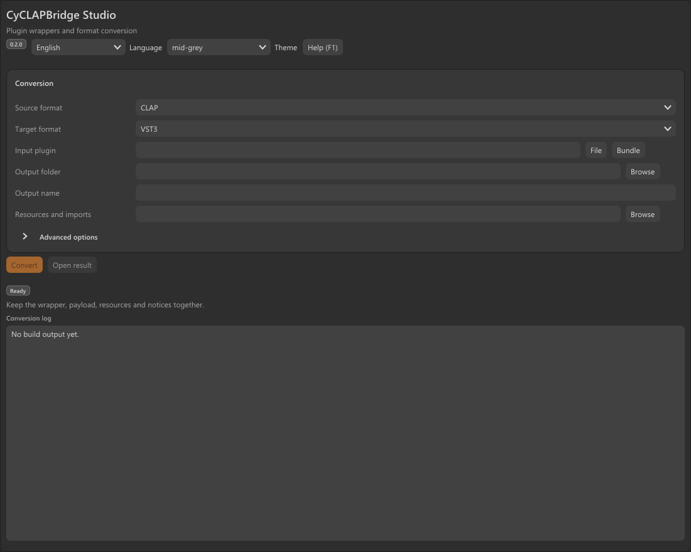

<table width="100%">
  <tr>
    <td width="300" align="left" valign="top">
      <a href="https://mrmybal.github.io/CyCLAPBridge/#/en/overview">Online manual</a><br>
      <a href="Documentation/Documentation.html#/en/overview">Offline HTML</a><br>
      <a href="https://github.com/MrMybal/CyCLAPBridge">Repository</a><br><br>
      <sub>README</sub><br><a href="README.md">English</a> · <a href="README.fr.md">Français</a>
    </td>
    <td width="400" align="center" valign="middle"><strong>CyCLAPBridge</strong><br><sub>C++20 · Studio · CLI</sub></td>
    <td width="300" align="right" valign="top">
      <p><sub>Application license</sub><br><a href="LICENSE"><strong>MIT</strong></a></p>
      <p><sub>Version</sub><br><a href="VERSION.md"><strong>0.2.0</strong></a><br><strong>IN DEVELOPMENT</strong></p>
      <a href="https://github.com/MrMybal/CyCLAPBridge/releases/download/v0.2.0/CyCLAPBridgeStudio-0.2.0-Windows-AMD64.zip">Download Windows x64</a><br><sub>Linux / macOS · prepared sources</sub>
    </td>
  </tr>
</table>

<h1 align="center">CyCLAPBridge</h1>

Standalone C++20 library, CLI and CyUI desktop application for hosting audio plugins and creating format wrappers. For plugin users building wrappers and DAW developers integrating hosting. The audio library has no dependency on CyAudioCore, CyDSP, CyDAW or CyUI. Studio links its own optional UI dependencies.

> **IN DEVELOPMENT · 0.2.0** — Studio now shares one interface across Windows, Linux and macOS. Windows x64 is validated; native Linux/macOS builds remain to be validated. Apple plugin integration tests are deferred. Read the [version notes and limitations](VERSION.md).

[](assets/screenshots/studio-en.png)

## Create wrappers or integrate a host

**Studio** converts a plugin or JSFX script into a compiled format wrapper. Choose the source and target formats, input, a new output folder and result name, then **Convert**. Conversion runs on a background thread and delivers the plugin, payload and notices into that folder. **Open result** opens the completed conversion. Studio defaults to English and includes French, a theme selector and a shared file browser. F1 opens the manual in the selected language.

The CLI also inspects modules. An optional resource directory preserves imports and assets. Keep the wrapper, `CyCLAPBridge-payload` and notices together. Conversion adapts an API around the original payload; it does not recompile that plugin or change its redistribution terms.

The static library exposes `cybridge::HostedPlugin` and direct `cybridge::ClapPlugin` hosting. Public headers keep plugin SDKs private. The DAW selects the process and owns workers, IPC, crash recovery and security sandboxing. Instances and buffers remain local to that process. Foreign plugins/scripts retain their own real-time behavior.

## Formats

| Format | Input | Output | Current scope |
| --- | --- | --- | --- |
| CLAP | Yes | Yes | Windows audio, automation, state, editors and wrappers |
| VST3 | Yes | Yes | Windows audio, automation, state and HWND editors |
| LV2 | Yes | Yes | Turtle metadata, audio, MIDI Atom, state and WindowsUI |
| JSFX | EEL2 through ysfx | No standalone native-to-script export | Windows audio, `@gfx`, CLAP/VST3/LV2 exports |
| AUv2 | Apple adapter | clap-wrapper export | Source integration; macOS validation deferred |
| AUv3 | No arbitrary-file import | Extension and container app | Xcode generation; macOS validation deferred |

AAX is excluded. A JSFX script cannot load arbitrary native plugins without a REAPER extension. The common API uses float32 and representable parameter/note/MIDI 1 events; float64, SysEx, MIDI 2, per-voice modulation and full transport translation are outside its current contract.

---

## Installation

Download the [Windows x64 application ZIP](https://github.com/MrMybal/CyCLAPBridge/releases/download/v0.2.0/CyCLAPBridgeStudio-0.2.0-Windows-AMD64.zip) from the [0.2.0 pre-release](https://github.com/MrMybal/CyCLAPBridge/releases/tag/v0.2.0). Studio needs an OpenGL 3.0 desktop driver. Plugin conversion requires **CMake 3.27+**, **Visual Studio 2022 Desktop development with C++** and a Windows SDK; the application itself is already compiled. Linux/macOS binaries remain pending native validation; see [platform builds](docs/Platforms.md). Plugin folders are not modified automatically.

The Studio application ZIP has `CyCLAPBridgeStudio.exe` directly at its root on Windows. Extract the complete ZIP and launch it; keep its `Resources` folder beside it. The application is already compiled. Format conversion still needs CMake and the native C++ toolchain described above. F1 opens the included manual. The separate developer installation provides `bin/cyclapbridge-cli.exe`, headers and the static library. Open `Documentation/Documentation.html` from the checkout, or `share/CyCLAPBridge/Documentation/Documentation.html` from a developer installation. Keep the whole manual directory. The [online manual](https://mrmybal.github.io/CyCLAPBridge/#/en/overview) opens the same reader in your browser; the included HTML remains available locally.

## Sources and build

```sh
git clone https://github.com/MrMybal/CyCLAPBridge.git
cd CyCLAPBridge
git submodule update --init third_party/clap-wrapper third_party/clap third_party/vst3sdk third_party/AudioUnitSDK third_party/CyUI third_party/glfw third_party/imgui
git -C third_party/vst3sdk submodule update --init base public.sdk pluginterfaces cmake
cmake -S . -B build/release -G "Visual Studio 17 2022" -A x64
cmake --build build/release --config Release
cmake --install build/release --config Release --prefix dist/CyCLAPBridge
```

SDKs are pinned; LV2/ysfx runtimes are retained snapshots. Configuration and conversion do not download dependencies. The default installation supplies the offline conversion sources. The Windows Studio preset links the MSVC runtime statically. Application packages are separate from the developer SDK; see [platform prerequisites](docs/Platforms.md).

<details>
<summary>Static library integration and optional targets</summary>

```cmake
find_package(CyCLAPBridge 0.2 CONFIG REQUIRED)
target_link_libraries(MyDaw PRIVATE CyCLAPBridge::CyCLAPBridge)
```

Select an installation with `CMAKE_PREFIX_PATH`. Include `<cyclapbridge/Plugin.h>` or `<cyclapbridge/Conversion.h>`; see the [DAW example](https://github.com/MrMybal/CyCLAPBridge/blob/main/examples/daw/main.cpp) and [library manual](https://mrmybal.github.io/CyCLAPBridge/#/en/library).

Set `CYCLAPBRIDGE_BUILD_CLI=OFF`, `CYCLAPBRIDGE_BUILD_GUI=OFF` and `CYCLAPBRIDGE_INSTALL_BACKEND=OFF` for a library-only installation retaining headers, documentation and notices. Tests are opt-in through `CYCLAPBRIDGE_BUILD_TESTS=ON`.

Studio uses CyUI with GLFW/OpenGL; these targets are excluded from a library-only build. AUv2 needs macOS and AudioUnitSDK; AUv3 also needs Xcode and signing. Native Linux/Apple validation is outstanding. CPack produces native ZIP/tar.gz packages using [the platform presets](docs/Platforms.md). The included manual needs no Node.js; regenerating it separately requires Node.js 22+ and the [.CyDocBuild instructions](https://github.com/MrMybal/CyCLAPBridge/blob/main/.CyDocBuild/README.md).

</details>

## CLI examples

```sh
cyclapbridge-cli capabilities
cyclapbridge-cli inspect --from jsfx --input "D:/Effects/Gain.jsfx"
cyclapbridge-cli convert --from clap --to lv2 --input "D:/Plugins/Gain.clap" --output "D:/Exports/Gain-LV2" --build
cyclapbridge-cli convert --from jsfx --to vst3 --input "D:/Effects/Gain.jsfx" --resources "D:/Effects" --output "D:/Exports/Gain-VST3" --build
cyclapbridge-cli build --project "D:/Exports/Gain-VST3"
```

`--plugin-id` selects a CLAP ID, LV2 URI or VST3 class ID. Inspection executes plugin code. LV2 export loads the plugin in a metadata helper during compilation. See the [CLI manual](https://mrmybal.github.io/CyCLAPBridge/#/en/cli).

---

## License

Original code uses [MIT](LICENSE). The pinned **VST3 SDK 3.8.0 build 66 is MIT**; VST3 conversion does not impose GPL on CyCLAPBridge. Payloads retain their own licenses. Keep full notices; see [distribution terms](docs/Licensing.md) and [pinned provenance](THIRD_PARTY.md).

| Library · source | License · terms | Use / scope |
| --- | --- | --- |
| [CLAP](https://github.com/free-audio/clap), [clap-wrapper](https://github.com/free-audio/clap-wrapper) | [CLAP MIT](https://github.com/free-audio/clap/blob/195b42a004144fab0b3cf95e9c067187d15365b7/LICENSE), [wrapper MIT](https://github.com/free-audio/clap-wrapper/blob/806bba0a5f792e3966b99c1561ab9952d3316d7c/LICENSE) | Host ABI and conversion backend |
| [VST3 SDK](https://github.com/steinbergmedia/vst3sdk) | [MIT](https://github.com/steinbergmedia/vst3sdk/blob/9fad9770f2ae8542ab1a548a68c1ad1ac690abe0/LICENSE.txt), nested notices | VST3 hosting/conversion |
| [AudioUnitSDK](https://github.com/apple/AudioUnitSDK) | [Apache-2.0](https://github.com/apple/AudioUnitSDK/blob/53a9a2008aae7fb1b0a9f093dd523b9b12f6c0d9/LICENSE.txt) | Apple conversion |
| [LV2](https://github.com/lv2/lv2), [Lilv](https://github.com/lv2/lilv), [Serd](https://github.com/drobilla/serd), [Sord](https://github.com/drobilla/sord), [Sratom](https://github.com/lv2/sratom), [Zix](https://github.com/drobilla/zix) | [ISC notices](third_party/licenses/) | Static discovery, metadata and LV2 hosting |
| [ysfx](https://github.com/jpcima/ysfx), WDL/LICE and embedded components | [Apache-2.0, Zlib, MIT/ISC and component terms](third_party/licenses/ysfx.txt); parser GPL-2.0-or-later **with Bison-exception-2.2** | JSFX audio/Windows `@gfx`; parser exception permits a separate larger-work license |
| fmt and PreSonus declarations in clap-wrapper | [MIT and public-domain notices](THIRD_PARTY.md) | Wrapper formatting/interfaces |
| [CyUI](https://github.com/MrMybal/CyUI), [Dear ImGui](https://github.com/ocornut/imgui), [GLFW](https://github.com/glfw/glfw) | MIT / zlib, [pinned terms](THIRD_PARTY.md) | Studio only; one ImGui target, Core/FilePicker and native window/OpenGL backends |
| [JetBrains Mono](https://github.com/JetBrains/JetBrainsMono) | SIL OFL 1.1, [retained notice](https://github.com/MrMybal/CyUI/blob/7019916ac1de987f86cef43b54a8f16fb0c6c9fc/third_party/jetbrains-mono/OFL.txt) | Font embedded by CyUI; Studio only |
| [CyDoc](https://github.com/MrMybal/CyDoc) | [MIT](Documentation/DocData/licenses/CyDoc.txt) | Separate offline manual; no C++ runtime dependency |
| [marked](https://github.com/markedjs/marked), [PrismJS](https://github.com/PrismJS/prism), [esbuild](https://github.com/evanw/esbuild) | [MIT notices](Documentation/DocData/licenses/) | Documentation generation only |

## References

- [English manual](https://mrmybal.github.io/CyCLAPBridge/#/en/overview) · [Manuel français](https://mrmybal.github.io/CyCLAPBridge/#/fr/overview)
- [Repository](https://github.com/MrMybal/CyCLAPBridge) · [Issues](https://github.com/MrMybal/CyCLAPBridge/issues) · [Version notes](VERSION.md)
- [Editor integration](docs/Editors.md) · [Architecture](docs/Architecture.md) · [Steinberg licensing FAQ](https://steinbergmedia.github.io/vst3_dev_portal/pages/FAQ/Licensing.html)
